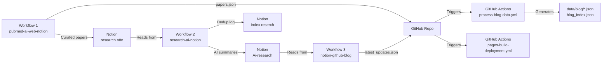

# ARCHITECTURE.md — NTWKKM Personal Website

**Last Updated:** 2026-11-12

## Overview

Static personal website hosted on GitHub Pages (`ntwkkm.github.io`). Serves as a professional portfolio for an Emergency Medicine physician & Clinical Informatics developer.

## Pages & Core Files

| File | Purpose |
| --- | --- |
| `index.html` / `index.css` / `index.js` | Homepage — dated paper ledger + tools index grouped by category |
| `blog.html` / `blog.css` / `blog.js` | Research reader — docked paper list, facets, one paper at a reading measure |
| `pl/index.html` | `[NEW]` NTWKKM Knowledge Vault — Auto-synced from private `NTWKKM/pl` |
| `manifest.json` | `[NEW]` PWA manifest — installable web app experience |
| `sw.js` | `[NEW]` Service Worker — offline caching and resilience |
| `_config.yml` | `[NEW]` Jekyll build config — excludes internal docs and metadata |
| `shared.js` | Shared utilities (fetch with retry, error/skeleton UI, a11y announcer, theme, service worker registration) |
| `shared.css` | Design tokens (the only place colours and fonts are declared), reset, buttons, shared components |

## Data Flow

```text
n8n Automated (via GitHub API):
  ├── papers.json            → Pushed by Workflow 1 (pubmed-ai-web-notion)
  │                            AI-curated top 12 EM papers, merged with existing, cap 70
  │                            Triggers: pages-build-deployment.yml (deploy only)
  └── latest_updates.json    → Pushed by Workflow 3 (notion-github-blog)
                               Latest 20 AI-summarized entries from Notion Ai-research DB
                               Triggers: process-blog-data.yml → auto-deleted after processing

GitHub Actions (process-blog-data.yml):
  ├── Merges latest_updates.json into the existing chunks (append-only, see Key Rules)
  ├── Deduplicates by Notion page ID, then by PMID
  ├── Keeps ≤200 posts per file → data/blog/research_chunk_*.json
  ├── Derives specialty + study design per post (taxonomy.js) → data/blog/index.json
  ├── Updates blog_index.json with relative paths
  └── Deletes latest_updates.json after successful processing

Static Data:
  ├── papers.json            → Paper slider data (index.html, automated by Workflow 1)
  ├── data/blog/index.json   → Compact list index read by blog.html (auto-generated)
  ├── data/blog/research_chunk_*.json → Full records, fetched per paper on demand (auto-generated)
  ├── blog_index.json        → List of chunk paths, read by process_blog.js (auto-generated)
  └── projects.json          → Tool entries with `category`, `icon`, optional `status` (manually maintained)

Private Repository Synchronization (pl/):
  pl/ repository (Private):
    └── Triggers update-pl-site repository_dispatch on push
  GitHub Actions (pages-build-deployment.yml):
    ├── Clones private NTWKKM/pl repository using PAT_FOR_PL
    ├── Injects into pl/ subdirectory during build
    └── Deploys securely to GitHub Pages without exposing repo access
```

### Pipeline Chains

```text
Path A — papers.json (Workflow 1, daily 02:01 & 05:01):
  n8n commits papers.json via GitHub API
    → Triggers: pages-build-deployment.yml (deploy to GitHub Pages)
    → update-readme.yml ignores (paths-ignore)

Path B — latest_updates.json (Workflow 3, daily 02:25):
  n8n commits latest_updates.json via GitHub API
    → Triggers: process-blog-data.yml (merge + chunk + index + delete)
    → Triggers: pages-build-deployment.yml (deploy to GitHub Pages)
    → update-readme.yml ignores latest_updates.json (paths-ignore)
```

### Key Rules

- `latest_updates.json` — **Ephemeral.** Pushed by n8n (Workflow 3), deleted by GitHub Actions `rm -f` safety step (`if: always()`). Must never be committed long-term.
- `data/blog/research_chunk_*.json` — **Auto-generated, append-only.** A post stays in the chunk it was first written to; an update replaces it in place; new posts go to the highest-numbered chunk until it holds 200, then a new chunk opens. Files whose content did not change are not rewritten, so a daily run touches one chunk. Order inside a chunk carries no meaning. Never edit manually.
- `data/blog/index.json` — **Auto-generated.** One row per post: `[id, title, timestampMs, pmid, chunkNumber, specialtyIdx[], designIdx, tags[]]`, newest first, plus the `specialties` and `designs` label lists the indexes point into. Rebuild without new data: `node .github/scripts/process_blog.js --reindex`.
- `blog_index.json` — **Auto-generated.** Chunk paths (e.g., `data/blog/research_chunk_1.json`). The reader no longer fetches it; the processor does. Never edit manually.
- `projects.json` `icon` — a key of the `ICONS` map in `index.js`; an unknown key falls back to a generic icon. `category` groups the list in file order.
- `papers.json` — **Automated.** Merged by Workflow 1 (dedup by link + PMID, cap 70 items, 2x/day). Do not edit manually.
- `projects.json` — **Manual.** Edit directly to add/remove tools.

> **Deduplication (Dual-Layer):** The processing script (`process_blog.js`) uses a **primary** `Map<id, post>` strategy (Notion page ID) and a **secondary** `Set<pmid>` check. If a new entry has the same PMID as an existing post but a different Notion ID, it is skipped as duplicate content. This prevents the same PubMed paper from appearing multiple times when it gets re-processed through different Notion pages.

## n8n Automation Layer (Upstream)

Three n8n workflows operate as **micro-automations** that feed data into this repository and Notion. They run on a self-hosted n8n instance and form the upstream pipeline for all research content.

### Notion Database Topology

The system uses **3 distinct Notion databases** that form a processing chain:

| Database | Notion Name | Role |
| --- | --- | --- |
| Source DB | `research n8n` | Raw paper intake — WF2 writes curated papers here, WF1 reads from here |
| Output DB | `Ai-research` | AI-processed papers with Thai summaries — WF1 writes, WF3 reads |
| Index Log | `index reserch` | PMID deduplication log — WF1 reads/writes to prevent reprocessing |

```text
Data chain: WF2 → research n8n → WF1 → Ai-research → WF3 → GitHub
```

### Workflow 2: `research-ai-notion` — Data Pipeline

**Purpose:** Fetch raw research papers, summarize with AI in Thai, generate tags, and store in Notion.

| Property | Value |
| --- | --- |
| Schedule | Daily at 02:15 and 05:15 |
| AI Model | Gemini 3.5 Flash |
| Output | Notion Database (`Ai-research`) |
| Batch Size | 5 papers per run (resource-constrained) |
| Source Filter | `Limit: 50` + Sort by Date Descending on `research n8n` DB (covers ~2 days of backlog) |

**Pipeline:**

```text
research n8n DB (source, limit 50, sort desc) → Wait(20s) → Aggregate
  → Get index reserch DB (log) → Filter Duplicates by PMID (JS, limit 5/run)
  → Loop per paper:
      PubMed E-Fetch API (abstract XML, retryOnFail) → Parse XML to plain text (JS)
      → Gemini 3.5 Flash (summarize Thai + study design + clinical relevance + 3 EN tags) → Clean JSON
      → n8n Data Table backup → Write to Ai-research DB (output)
      → Wait(15s) → Update index reserch DB (log) → Wait(15s) → Next
  → LINE notification on loop completion
```

**AI Output per Paper:**

1. Extracted title
2. Thai summary (Objective, Methods, Results & Statistical Analysis, **Study Design**, **Clinical Relevance**)
3. Three English keyword tags

> **Note:** `study_design` and `clinical_relevance` are embedded within the `Comment` field of `Ai-research` DB to avoid schema changes. Drug/protein/technique names are preserved in English per prompt directive.

**Deduplication:** JS code compares incoming PMIDs against the `index reserch` Notion DB. Only unprocessed PMIDs proceed.

**Rate Limiting:** Wait nodes (15–20s) are inserted between Notion/PubMed API calls to avoid throttling. All HTTP nodes have `retryOnFail: true`.

**Internal Backup:** Each processed paper is also written to an n8n Data Table (`Notion-AI-Research`) before Notion, serving as an audit log.

---

### Workflow 1: `pubmed-ai-web-notion` — Expert Curation

**Purpose:** Search PubMed for latest EM research, AI-curate top 12 clinically significant papers, publish to website and Notion.

| Property | Value |
| --- | --- |
| Schedule | Daily at 02:01 and 05:01 |
| AI Model | Gemini 2.5 Pro (AI Agent, `retryOnFail`) |
| Search Scope | PubMed E-Search `retmax=300`, `retmode=json`, `usehistory=y` |
| Output | `papers.json` (GitHub) + `research n8n` DB (Notion) |
| Trigger | Schedule (keyword: `emergency`, 7-day window) **or** LINE chat via sub-workflow |
| AI Output | **Structured JSON Array** (not freeform text) |

**Pipeline:**

```text
Trigger A (Schedule): PubMed E-Search (term="emergency", retmax=300, retmode=json)
Trigger B (LINE chat): AI Router (Gemini) extracts medical term → E-Search (retmode=json)
  → Parse JSON (querykey + webenv + idlist) → Wait(20s) → E-Fetch (titles + PMIDs, XML)
  → Parse XML → Aggregate into summary text
  → Gemini 2.5 Pro AI Agent (role: Senior EM Consultant)
      ├── Output: JSON Array [{title, comment, pmid}, ...]
      ├── Select Top 12 Clinical Significance from ~300 candidates
      ├── Criteria: practice-changing, controversial, innovative
      └── 1-sentence Thai summary per paper
  → LINE push (auto-formatted from JSON for readability)
  → JSON.parse AI output → Extract papers with PMID + empty-result guard
  → GitHub: Get existing papers.json → Merge (dedup by Link + PMID, cap 70) → Edit file
  → Wait(20s) → Notion: Query research n8n DB → Aggregate titles
  → Wait(20s) → Filter duplicates (JSON.parse + PMID dedup) → Loop: Create pages (10s Wait)
  → LINE notification on completion
```

**Key Detail:** This workflow uses **structured JSON output** from the AI Agent, parsed via `JSON.parse()` instead of fragile regex. The merge step deduplicates by both **link URL** and **PMID**. Empty AI results short-circuit before GitHub commit. The LINE message auto-formats the JSON array into a readable numbered list.

---

### Workflow 3: `notion-github-blog` — Content Syndication

**Purpose:** Pull AI-summarized research from Notion and sync to GitHub as the blog data feed.

| Property | Value |
| --- | --- |
| Schedule | Daily at 02:25 |
| Input | Notion Database (`Ai-research`) — latest 20 entries |
| Output | `latest_updates.json` (GitHub, ephemeral) |

**Pipeline:**

```text
Notion Ai-research DB (sorted by last_edited, limit 20)
  → Aggregate → Generate full PubMed URLs (https://pubmed.ncbi.nlm.nih.gov/[PMID]/)
  → Format as JSON → Push as latest_updates.json to GitHub
  → Triggers process-blog-data.yml (merge + chunk + index)
  → LINE notification
```

---

---

### Workflow Orchestration

```text
Schedule Overview (Daily):

  02:01  Workflow 1 — PubMed search + AI curation → papers.json (GitHub)
  02:15  Workflow 2 — Raw paper pipeline → Notion Ai-research DB
  02:25  Workflow 3 — Notion → latest_updates.json (GitHub)
                        └── Triggers: process-blog-data.yml → chunked blog data
                        └── Triggers: pages-build-deployment.yml → deploy

  05:01  Workflow 1 — Second run (same as above)
  05:15  Workflow 2 — Second run (same as above)
```

### Data Flow: Medical Research Pipeline



### External Services

| Service | Role |
| --- | --- |
| **PubMed API** | E-Search + E-Fetch for research paper discovery and abstract retrieval |
| **Gemini 3.5 Flash** | Fast, cost-efficient summarization (Workflow 2) |
| **Gemini 2.5 Pro** | High-quality clinical curation with expert persona (Workflow 1) |
| **Notion** | Primary data warehouse — stores all processed papers, index logs, and curated selections |
| **LINE Messaging API** | Notification channel + chat-based trigger for on-demand searches |
| **GitHub API** | Direct file commits (`papers.json`, `latest_updates.json`) |

## NTWKKM Knowledge Vault (`pl/`)

The NTWKKM Knowledge Vault is an automated, dynamic resource hub and clinical informatics dashboard hosted in a separate private repository (`NTWKKM/pl`) and securely aggregated into the main site at build time.

### System Components

1. **Frontend Interface:** Built with vanilla HTML/CSS/JS, enforcing professional accessibility standards (WCAG 2.1) and dynamic theming. Features passcode authentication securely hashed client-side via Web Crypto API.
2. **Workflow Visualization:** Client-side viewer rendering automated n8n workflows using Cytoscape.js and Dagre algorithms from JSON payloads.
3. **Automated Data Pipeline:** Bookmarking and external link management is fully automated via an n8n workflow leveraging Google Gemini for AI formatting and deduplication.

### Security & Maintenance Protocols

- **Build-Time Aggregation (`pages-build-deployment.yml`):** Utilizes a scoped Personal Access Token (PAT) to clone the private `NTWKKM/pl` repository into the `pl/` subdirectory during the GitHub Actions deployment phase. The frontend UI and code logic function natively at `ntwkkm.github.io/pl/` without exposing the original repository structure.
- **Cross-Repository Synchronization:** The `trigger-main-website-and-process-auth.yml` workflow in the private `pl` repository sends a `repository_dispatch` payload to this main repository upon any push, triggering an automated rebuild.
- **Stateless Execution:** Fetches data directly from GitHub infrastructure (Tree API), ensuring real-time accuracy and high availability without a backend database.

## CI/CD Workflows

| Workflow | Trigger | Concurrency Group | Purpose |
| --- | --- | --- | --- |
| `process-blog-data.yml` | Push to `latest_updates.json` or manual | `blog-data-processing` | Merge, deduplicate, chunk blog data |
| `pages-build-deployment.yml` | Push to `main`, manual, or `repository_dispatch` | `pages` | Build, fetch private `pl` repo, and deploy to Pages |
| `update-readme.yml` | Push to `main` (ignores `README.md`, `latest_updates.json`) | `readme-update` | Auto-generate repository tree in README |

> **Concurrency:** All workflows use `cancel-in-progress: false` to ensure sequential execution. This prevents deployment conflicts when multiple n8n commits arrive in quick succession.

### CI Scripts

| Script | Purpose |
| --- | --- |
| `.github/scripts/process_blog.js` | Merge `latest_updates.json` into append-only chunks, deduplicate by Notion ID (primary) + PMID (secondary), write `data/blog/index.json` and `blog_index.json`. Exits non-zero on unparseable input. `--reindex` rebuilds the index only |
| `.github/scripts/taxonomy.js` | Fixed specialty list (multi-label, from tags then title) and study-design list (from the `Study Design:` summary line). Append new entries at the end: the index stores positions |
| `.github/scripts/process_blog.test.js` | Unit tests for merge, chunking, index and taxonomy: `node --test .github/scripts/*.test.js` (run by `browser-test.yml`) |
| `.github/scripts/generate_readme.js` | Generate repository file tree for README.md (collapses `data/blog/` to summary) |

## Theming

All pages use `data-theme="light|dark"` on `<html>` with `localStorage.theme` persistence; first-time visitors inherit `prefers-color-scheme`. An inline script in `<head>` sets the attribute before first paint (no flash). Token values and usage rules live in `DESIGN.md`; `shared.css` is the only file that declares a colour or a font family.

## Frontend Architecture

- `shared.css` — tokens, reset, `.btn` / `.icon-btn`, skeleton and error states, offline pill, update bar, `<dialog>`, reduced motion.
- `index.css`, `blog.css` — layout only, tokens only.
- `shared.js` — `fetchWithFallback()` (retry with backoff, `cache: 'no-cache'` revalidation instead of cache-busting query strings), `createErrorUI()` (retry callbacks dispatched by one delegated listener), `createSkeletonUI()`, `escapeHTML()`, `sanitizeURL()`, `debounce()`, announcer, theme toggle, service worker registration.
- `index.js`, `blog.js` — page logic, loaded as external files (cacheable, no inline handlers).

All JSON data is escaped (`escapeHTML`) or protocol-checked (`sanitizeURL`) before DOM injection; both are defined only in `shared.js`.

## Homepage (index.html)

- **Paper ledger:** `papers.json` is grouped by curation date; the date sits in a narrow rail, each paper is a title link to PubMed with its one-line Thai comment. The first days (≥10 papers) show; "Show all N papers" reveals the rest. No carousel, no auto-scroll.
- **Tools index:** `projects.json` grouped by `category`, one bordered list per group.

## Research Reader (blog.html)

- **Index-first loading:** start-up fetches `data/blog/index.json` (~370 KB, ~125 KB gzipped) and the one chunk holding the open paper. The other chunks load only when the reader focuses the search box (full-text search) and are cached in memory.
- **Facets:** Specialty (multi-select, OR) and Study design (single-select), folded behind the "Topics" control. Counts come from the index. Raw AI tags stay visible on each paper; clicking one searches for it.
- **Search:** every term must appear as a substring (AND). Title hits rank above tag/PMID/specialty hits, above summary-only hits; ties stay newest first. Until the chunks arrive the status line reads "by title and tag".
- **URL state:** `?id=` (paper), `?q=` (search), `?cat=` (specialty ids, comma-separated), `?design=` (design id), `?pmid=` (open by PMID). Legacy `?tag=` links are read as a search. Opening a paper pushes history; filter changes replace it.
- **Default paper:** with no `id`, the first paper of the current list opens (ADR-010).
- **Summary sections:** `parseSummary()` in `blog.js` turns the AI summary into Objective / Methods / Results / Study design / Clinical relevance. A line is a heading only when a known label (Thai or English) is followed by a colon.
- **Citation:** Vancouver, APA, BibTeX, Markdown, built from title + PMID only. Authors, journal and year are not stored, so none are printed; the dialog says so.
- **List:** 20 per page; the page follows the open paper when stepping with the arrow buttons or ← / → keys. `/` focuses search, `Esc` closes the drawer.
- **Layout:** ≥1025px the list is docked and can be folded; below that it is an off-canvas drawer (`inert` while closed) and Papers / Prev / Cite / Next move to a bottom bar.

## Caching & Offline Resilience

Service worker `sw.js` (cache version `v6`):

- **Handles only this repo's files:** the shell (`/`, `index.*`, `blog.*`, `shared.*`, `manifest.json`) and the data (`papers.json`, `projects.json`, `blog_index.json`, `data/blog/*`). Its scope is `/`, which also covers sibling project sites (`/pl/`, `/er-hub/`, ...); those requests pass through untouched.
- **Network-first with a 4 s timeout, cache fallback** for both groups. Online readers always get current code and data; offline readers get the last good copy (papers whose chunk was fetched before).
- **Cache keys drop the query string**, so no parameter can create duplicate entries.
- **Google Fonts:** cache-first in `ntwkkm-fonts-v1`.
- **Updates:** the worker activates immediately; a page that was already controlled shows a "A new version is ready / Reload" bar. It never reloads by itself.
- Bump `VERSION` in `sw.js` when the shell file list changes.

## PWA

`manifest.json`: installable, `theme_color` `#ECECEE`, SVG icons (32/192/512) with separate full-bleed maskable variants.
